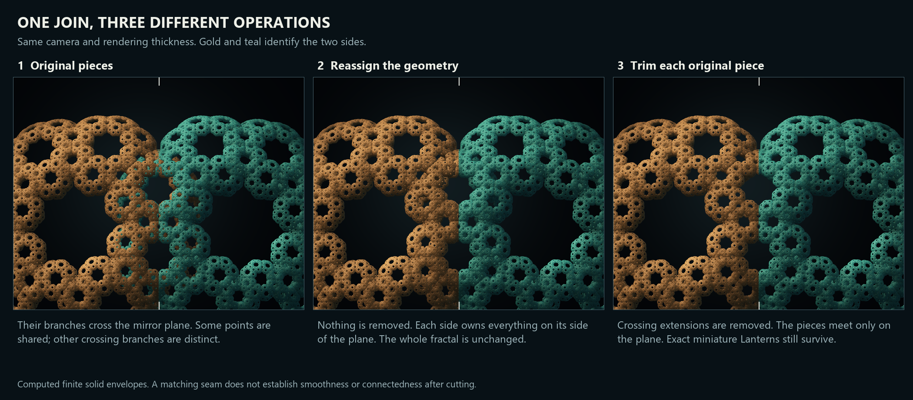
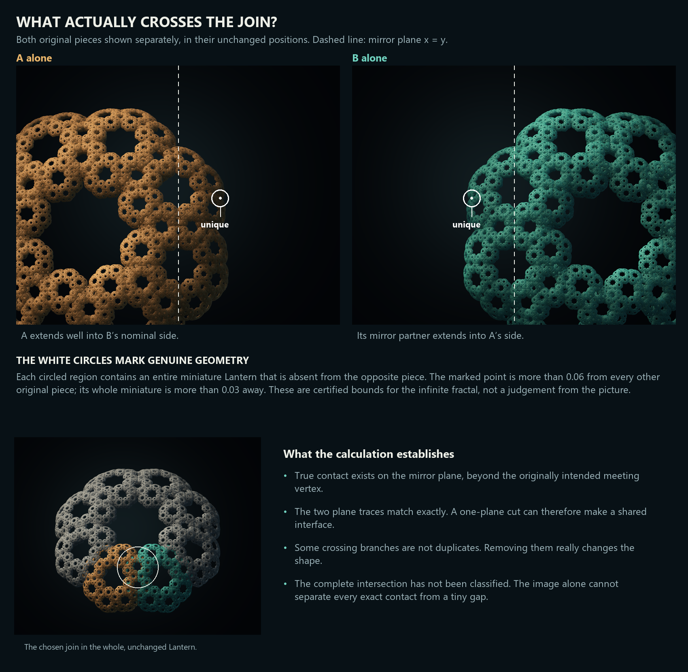
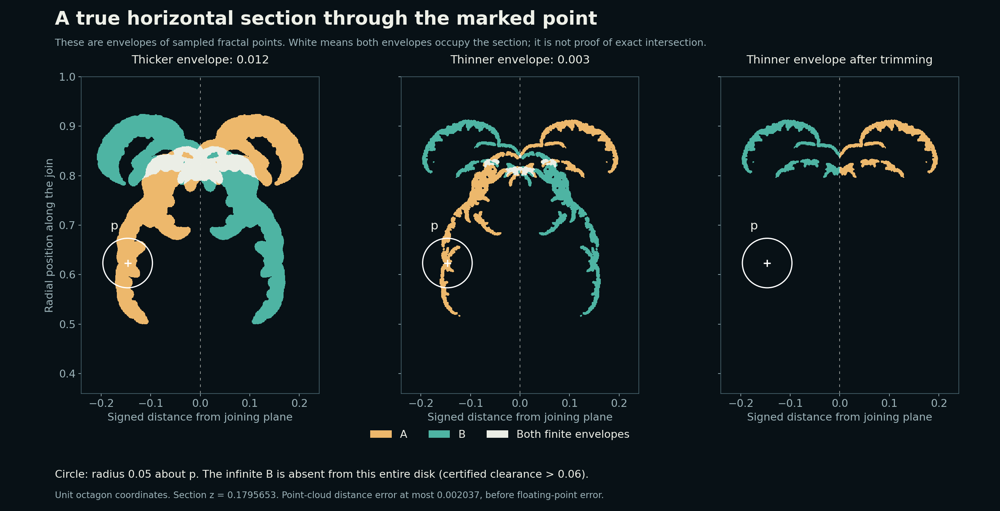
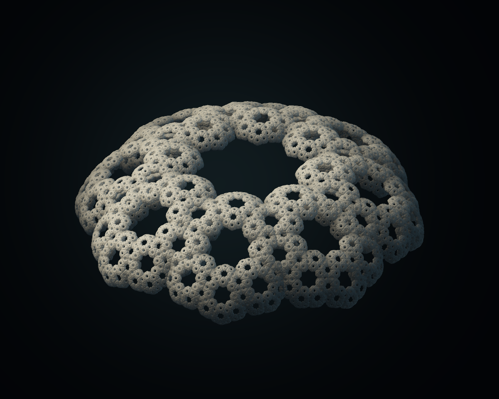

# Toward a cleaner Lantern join

The **trimmed join is the preferred visual direction** from this study. Two neighbouring miniature Lanterns are cut back to their shared mirror plane, so they meet at one interface instead of extending through each other's side. The original Lantern remains the reference object, with its recipe and existing assets unchanged.


This is a study of **one join between two of the eight pieces**. It is not an all-eight trim, a replacement recipe, or a completed new fractal family. Its purpose is to establish what this cleaner-looking interface changes and how much exact self-similarity survives.

## What the comparison shows



The original pieces are mirror partners, but some of the geometry which crosses their dividing plane is distinct. Deleting only duplicate ownership leaves the same occupied shape. The preferred trim changes that shape by removing the portions which extend across the plane.

The metallic surface is a finite rendering envelope of the fractal. Its apparent thickness can make contacts look more substantial, but the interleaving is not solely a display artefact: the exact calculation identifies a point in one piece which crosses the plane and is separated from every other piece.



## A matching interface, with genuine geometry removed

The two pieces have **exactly the same trace on the mirror plane**. Keeping each on its own side therefore makes them meet only along that common trace. This provides a precise geometric basis for the cleaner interface seen in the image.

It does not mean that everything underneath the neighbouring piece was a duplicate. The certified witness lies more than `0.06` units from every other first-generation piece. A whole smaller Lantern around that witness is removed by the trim; the other pieces do not supply it again. These lengths use the original unit-octagon coordinates, before display normalization.



The section is a numerical visualization of finite-thickness envelopes. The proof of separation comes from complete interval-checked covers of the infinite pieces. The full intersection set remains unclassified; the pictures do not prove that every original contact lies on the dividing plane.

## Self-similarity survives inside the trimmed pair

One complete miniature, `f_00(K)`, remains strictly on the retained side. Every smaller descendant inside it remains too. Thus the edited pair contains exact original Lantern copies at arbitrarily small scales. This is established for the pair itself, independently of the six untouched pieces elsewhere in the object.



The trimmed pair also has **the same Hausdorff dimension as the original Lantern**. Its numerical value is still unresolved; equal dimension follows from containing a scaled copy of the original while remaining a subset of it.

The change occurs at the level of the whole object's construction rule. The edited whole is different from the original, so it cannot satisfy the original eight-map equation. This does not establish that no different self-similar rule could generate it. It also does not promise that every camera crop isolates a complete miniature without neighbouring geometry.

## The exact construction

Let `K` be the [fixed L3-30 Lantern](definition.md), with contraction ratio `r = sqrt(2) - 1`. Choose

```text
A = f_0(K), B = f_1(K)
P = {x = y}
ell(x,y,z) = (x-y)/sqrt(2)
H+ = {ell >= 0}, H- = {ell <= 0}
D = (A intersect H+) union (B intersect H-)
C = D union f_2(K) union ... union f_7(K)
```

`D` is the trimmed pair; `C` places it back into the otherwise unchanged Lantern. Reflection `S(x,y,z)=(y,x,z)` exchanges `A` and `B`, so

```text
A intersect P = B intersect P
(A intersect H+) intersect (B intersect H-) = A intersect P
```

The outward-interval certificate proves:

| Result | Certified bound or inclusion |
| --- | --- |
| A distinct point crosses the plane | `p=f_04(v_5)` has `ell(p) < -0.14`. |
| No other piece duplicates it | `distance(p,f_j(K)) > 0.06` for every `j=1,...,7`. |
| A whole miniature is removed | `f_04555(K)` lies below `ell=-0.11` and more than `0.03` from every other first-generation piece. |
| A whole miniature survives | Every point of `f_00(K)` has `ell > 0.36`. |
| Dimension is preserved | `f_00(K) subset D subset C subset K`, hence `dim_H(D)=dim_H(C)=dim_H(K)`. |

Since `C` is a nonempty compact proper subset of `K`, uniqueness of the attractor for the original eight contractions implies `C != union_i f_i(C)`. The underlying existence and uniqueness theorem is [Hutchinson, *Fractals and Self Similarity* (1981), Section 3.1(3)](https://maths-people.anu.edu.au/~john/Assets/Research%20Papers/fractals_self-similarity.pdf).

## What remains open

A matching set on a plane is not yet a smooth surface. Connectivity after trimming, the shape and number of seam components, matching tangents and the topology of a physical approximation remain unresolved. The exact infinite Lantern has zero three-dimensional volume; capping or thickening a cut introduces further choices.

Applying this treatment consistently to all eight joins is a separate experiment. A new rule that repeats compatible interfaces at every scale would also need its own construction and proof. Neither result is claimed here.

## Evidence and reproduction

The [mathematical argument](../research/join-study/MATH.md), [interval certificate](../research/join-study/data/interface-certificate.json) and [numerical anatomy](../research/join-study/OVERLAP.md) accompany this page. The certificate covers whole infinite pieces, rather than checking only sampled points.

From the repository root, install the base mathematical requirements and run:

```sh
python -m pip install -r requirements.txt
python research/join-study/source/certify_interface.py
```

The optional numerical screen has its own lightweight [requirements file](../research/join-study/requirements.txt). It writes a small JSON summary, without committing point clouds:

```sh
python -m pip install -r research/join-study/requirements.txt
python research/join-study/source/analyze_overlap.py
```

To reproduce the pair renders, install `visual-requirements.txt` and run:

```sh
python -m pip install -r visual-requirements.txt
python research/join-study/source/render_join.py
```

These are study outputs. The [original results and limitations](results.md), [reference definition](definition.md) and original stills and video continue to describe the unchanged Lantern.
