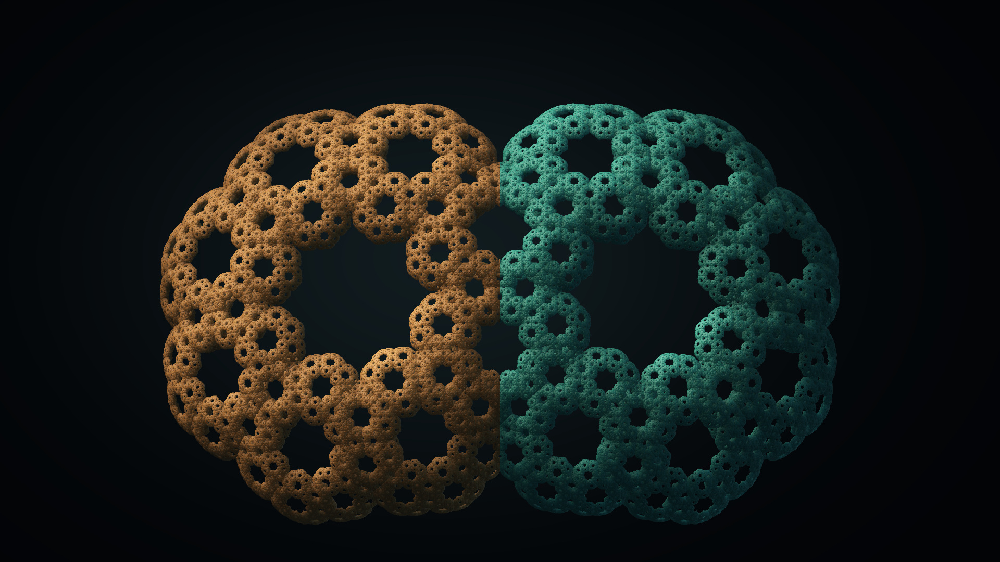

# Images, film and TouchDesigner

The six stills and silent film show Porous Lantern's mirrored pair D: two spatial fractal pieces meeting at one plane. Copper and teal distinguish the two sides, while close views reveal the generating motifs retained inside them.

The [gallery](https://okwhynot-wtf.github.io/porous-lantern/gallery.html) provides the complete image set and downloadable PNG masters. The compositions include the pair, its profile, the interface and finer detail. The hero master is 1920 × 1080; the other five are 1920 × 1440. [Still metadata](../media/stills/manifest.json) records the rendering parameters and file hashes.

## The film

[Watch or download the film](https://okwhynot-wtf.github.io/porous-lantern/assets/porous-lantern-hero.mp4). A slow camera arc moves into a closer view of the central interface. The silent loop is 24 seconds at 1280 × 720 and 24 frames per second, encoded as H.264.

Frames are rendered directly from TouchDesigner TOP output and encoded into the playback movie. The [film receipt](../media/film-master.json) records the completed export's duration, frame count and dimensions; the [media verification record](../media/verification.json) documents checks on the delivered file.

A closer camera view can show exact repeated motifs inside D. It should not be interpreted as proof that every camera crop is a copy of the complete displayed pair.

## The visible surface

D has zero ordinary three-dimensional volume. A finite envelope gives it a solid appearance. Sampling, interpolation, tracing tolerance and thickness limit the detail shown. A pixel alone is not evidence that an exact passage is blocked, that a seam is smooth or that the full mathematical set is connected.

The two half-space conditions are part of the geometry. Lighting and material colour help reveal those pieces; they do not establish the matching interface. That identity follows from reflection, as explained in [the interface account](joins.md).

## TouchDesigner

The [project file](../touchdesigner/Porous-Lantern.toe) provides the native visualization. Its GLSL TOP evaluates the mirrored geometry. View presets choose a composition; Phase scrubs the camera motion; Exposure adjusts brightness. The export controls provide Save still, Render loop and Cancel, with an output destination and FFmpeg executable setting.

The export workflow reads the rendered RGB tiles from TouchDesigner to the CPU. FFmpeg encodes those frames; geometry and shading are rendered in the application. This keeps the film tied to the native TOP output.

The scene definition and the [mathematical checks](reproduce.md) are separate from display settings. Changing a camera, a light or an envelope thickness changes the presentation; the exact set remains the D defined in the [construction](definition.md).
